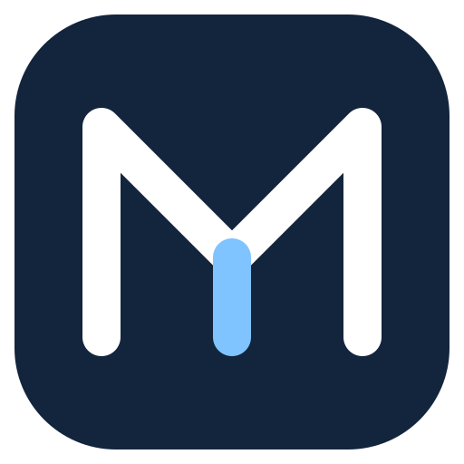

  

<h1 align="center">Mumtaz Studio</h1>

  <b>Vector illustration, page layout and print design in one independent hybrid application for web and desktop.</b> 
  Pages and layers, curves and nodes, artistic and paragraph text, fills and outlines, live effects, symbols, PDF/X and real <code>.cdr</code> files, 
  in one native program for Windows, macOS and Linux, and in the browser.

  
  
  
  
  

  <a href="https://github.com/kholilmuflikhun/mumtaz-studio/releases"><b>Releases</b></a> &middot;
  <a href="https://apps.microsoft.com/detail/9P50L12VHF33">Microsoft Store</a>* &middot;
  <a href="web/">Web application source</a> &middot;
  <a href="docs/features.md">Feature status</a> &middot;
  <a href="CONTRIBUTING.md">Contribute</a>

  

  * The Microsoft Store listing is an upstream TraceDraw distribution and is not a Mumtaz Studio release or endorsement.

 
